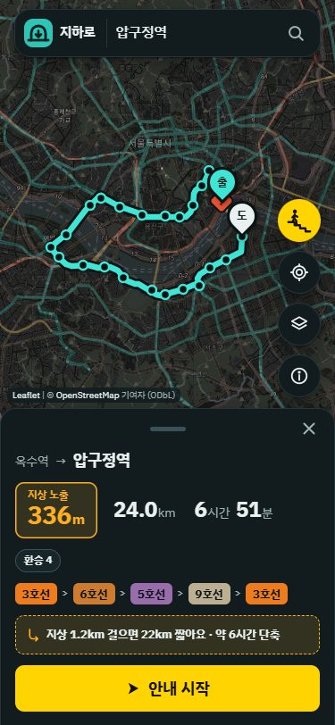
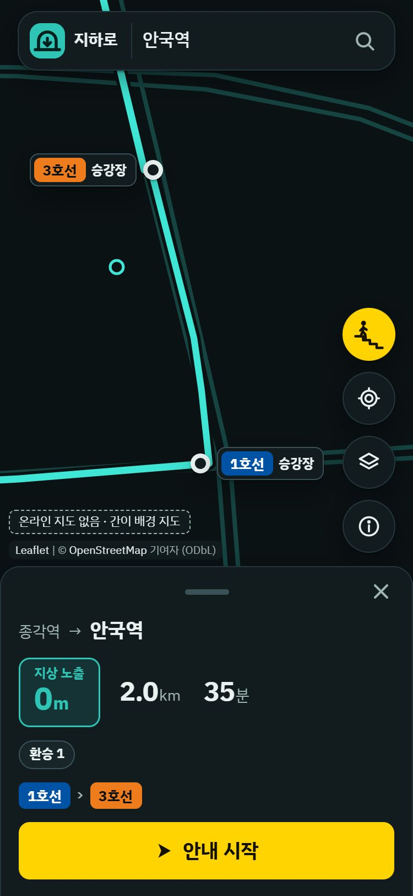
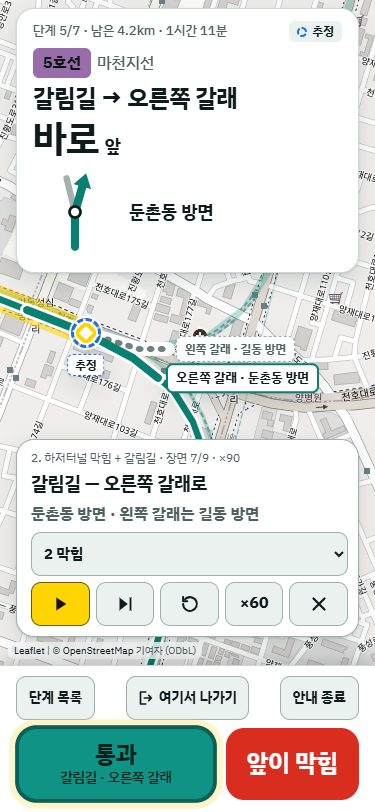

# 지하로

전쟁으로 지상 이동이 위험할 때, 전국 철도망의 실제 터널 연결 구조를 분석해 지상에 나가는 거리가 가장 짧은 경로를 GPS와 인터넷 없이도 한 걸음씩 안내하는 웹 앱.

COM's 해커톤 2026 · 주제: 전쟁 · 혼자 참가

- 서비스: https://cy7mvpboy.github.io/underground-route/
- 시연 모드: https://cy7mvpboy.github.io/underground-route/#demo
- GitHub: https://github.com/cy7mvpboy/underground-route
- 발표 자료: https://cy7mvpboy.github.io/underground-route/slides/ (PDF: `docs/발표.pdf`), 계획서: `docs/계획서.pdf`

| 대안 카드 | 환승 통로 | 갈림길 안내 |
|---|---|---|
|  |  |  |

## 무엇을 하나

지하로는 철도 선로를 지하(터널)·교량·지상으로 나눈 전국 그래프 위에서 지상 노출이 가장 적은 길을 찾아 안내한다. 지하로만 가는 길이 있으면 그 길을, 없으면 지상 구간이 가장 짧은 길을 고르고 노출 구간을 표시한다.

- 지상 노출 최소 경로: 지상 1m를 지하 1km와 같은 비용으로 계산한다.
- 가장 가까운 지하로: 한 번 눌러 가까운 지하역 출구 후보 3곳을 거리순으로 보여 주고 안내한다.
- 대안 카드: 지상을 조금 걸으면 시간이 20% 이상 또는 30분 이상 줄 때만 한 줄로 제안한다.
- 단계 안내: 노선·선 이름, 방면, 지나는 역, 환승 카드(승강장 깊이, 계단 위치)를 단계별로 보여 준다.
- 갈림길 안내: 역 사이에서 선로가 갈라지는 곳을 왼쪽·오른쪽·직진과 Y자 그림으로 알려 준다.
- 앞이 막힘 재탐색: 막힌 구간을 빼고 마지막 확인 지점에서 다시 찾는다. 막은 구간은 '모두 풀기' 전까지 이후 탐색에서도 계속 뺀다.
- 여기서 나가기: 지금 위치에서 닿을 수 있는 지상 출구(출구, 터널 출입구, 수직구·비상 출구, 차량기지)를 거리순으로 보여 준다.
- 지하로 갈 수 있는 곳: 도착한 역에서 지하만 따라 30분·1시간·2시간·4시간 안에 닿는 역을 지도에 칠한다.
- 걸음 기반 위치 추정: 폰 가속도 센서로 걸음을 세고 보폭을 자동으로 보정해, GPS가 없는 터널 안에서 위치를 추정한다.
- 장소 검색: 시군구·읍면동, 병원·학교·관공서, 아파트 단지 등 6만여 곳을 오프라인으로 검색하고, 인터넷이 되면 온라인 검색을 더한다.
- 시연 모드: 한 사람의 이야기(공습경보 → 가족 약속 장소)와 짧은 시나리오 2개를 GPS·인터넷 없이 재생한다.

전국 운행 철도(도시철도·광역전철·일반철도·고속철도)를 대상으로 한다. 역 1,275곳(지하역 577곳), 출구 4,551곳, 환승 425건을 다룬다.

## 사용법

1. 휴대폰 브라우저에서 서비스 링크를 연다.
2. 출발·도착을 검색하거나 지도를 눌러 정한다. 급하면 '가장 가까운 지하로 대피'를 누른다.
3. 결과 카드에서 지상 노출 거리, 걷는 시간, 환승 횟수를 확인하고 '안내 시작'을 누른다.
4. 안내 화면에서 단계를 따라간다.
   - 역에 닿으면 '도착', 갈림길을 지나면 '통과'를 눌러 위치를 바로잡는다.
   - 길이 막히면 '앞이 막힘'을 눌러 그 구간을 빼고 다시 찾는다.
   - 지상으로 나가야 하면 '여기서 나가기'로 가까운 출구 후보를 본다.
5. 한 번 열면 앱과 철도망 데이터(약 7.6MB)가 기기에 저장된다. 정보 탭에 '오프라인 사용 준비됨'이 뜨면 인터넷 없이 다시 열어도 경로 탐색·안내·재탐색·장소 검색이 된다. 정보 탭의 '홈 화면에 추가'(iOS는 공유 → 홈 화면에 추가)로 앱처럼 설치할 수 있다. 인터넷이 되면 지상 도보 구간이 실제 길로 바뀌고, 배경 지도 타일은 본 곳만 저장된다.

시연 모드는 주소 끝에 `#demo`를 붙이거나(`#demo2`·`#demo3`은 해당 시나리오부터), 정보 탭의 '발표용 재생 시작'을 누르면 열린다.

시연 시나리오:

1. 한 사람의 이야기(기본 속도 ×60에서 약 92~95초, 장면 14개): 평소에 한성백제역을 '가족 약속 장소'로 저장 → 공덕오거리 부근 거리에서 공습경보 → '가장 가까운 지하로'로 공덕역 2번 출구(지상 138m) → 5호선 승강장에서 '가족 약속 장소까지 지하로'(23.1km, 지상 노출 0m) → 한강 아래 5호선 마포–여의나루 터널에서 '앞이 막힘' → 마포역으로 834m 되돌아가 한강 아래 다른 하나(5호선 광나루–천호)로 다시 찾기(23.8km, 지상 노출 0m) → 강동 지나 갈림길(오른쪽 갈래, 둔촌동 방면) '통과' → 도착(지하에 들어간 뒤 지상 노출 0m). 장면 사진: `docs/screens/story-01-save.jpg` ~ `story-14-arrive.jpg`(375×812 어두운 화면)
2. 부산역에서 해운대까지 18.5km 전 구간 지하, 환승 2번
3. 장거리 피난의 한계(서울역에서 부산역)

시연 중 저장한 '가족 약속 장소'는 메모리에만 두고, 이 브라우저에 저장해 둔 장소는 건드리지 않는다.

## 실행 방법 (로컬)

서버 없이 동작하는 정적 파일이다. `web` 폴더를 정적 서버로 열면 된다. Python이 있으면 프로젝트 폴더에서 다음을 실행한다.

```
python -m http.server 8000 -d web
```

브라우저에서 http://localhost:8000/ 를 연다. 시연은 http://localhost:8000/#demo 이다.

- `web/index.html`은 `<!doctype>`·`<html>`이 없는 문서 조각이다. 브라우저는 그대로 그린다.
- 배경 지도 타일, 온라인 장소 검색(Photon), 지상 도보 길(FOSSGIS OSRM), Leaflet, 글꼴은 인터넷에서 받는다. 인터넷이 없으면 철도망 선과 안내만 보인다.
- GitHub Pages 배포는 `.github/workflows/pages.yml`이 한다. `main` 브랜치에 `web/**`가 바뀌어 올라가면 `index.html`을 완전한 HTML 문서로 감싸고 스크립트 주소에 커밋 id를 붙여 배포한다.

## 데이터 다시 만들기

`web/data/`의 JSON은 미리 만들어 저장소에 들어 있다. 다시 만들려면 Python 3.13이 필요하고, 표준 라이브러리만 쓴다. 프로젝트 폴더에서 아래 순서로 실행한다. 원본은 `data/raw/`(git 제외)에 둔다.

### 1. 직접 내려받을 파일

| 저장 위치 | 내용 | 받는 곳 |
|---|---|---|
| `data/raw/seoul/transfer_distance_20250331.csv` | 서울교통공사 환승역 환승거리·소요시간 | [공공데이터포털 15044419](https://www.data.go.kr/data/15044419/fileData.do), [서울 열린데이터광장 OA-13290](https://data.seoul.go.kr/dataList/OA-13290/F/1/datasetView.do) |
| `data/raw/seoul/station_depth_20241104.csv` | 서울교통공사 역사심도정보(CP949) | [서울 열린데이터광장 OA-13305](https://data.seoul.go.kr/dataList/OA-13305/F/1/datasetView.do) |
| `data/raw/transfer/fast_transfer_20250923.csv` | 국토교통부 철도역 빠른 환승 정보(CP949) | [공공데이터포털 15151816](https://www.data.go.kr/data/15151816/fileData.do) |
| `data/raw/transfer/exit_area_20260902.csv` | 서울교통공사 역별 역세권 현황(CP949) | [공공데이터포털 15044230](https://www.data.go.kr/data/15044230/fileData.do) |
| `data/raw/passage/seoul_station_passage.csv` | 서울시 지하철역 연계 지하도 공간정보(CP949) | [공공데이터포털 15098161](https://www.data.go.kr/data/15098161/openapi.do) |

환승거리 파일은 2025-03-31 기준본을 썼다. 위 주소의 데이터셋은 이후 갱신되었을 수 있다.

### 2. OSM 철도 데이터 받기와 합치기

공개 Overpass API에 한 번에 하나씩 요청한다(쿼리는 `scripts/queries/`). `ways_*`는 요청 사이에 20초씩 쉰다.

```
python -I scripts\overpass_fetch.py scripts\queries\ways_A1.overpassql data\raw\ways_A1.json
```

같은 방식으로 `ways_A2`, `ways_B`, `ways_C`, `ways_D`, `ways_E`, `stations`, `stops`, `entrances`, `routes`, `han_river`, `region_nodes`를 받고, `region_nodes_jeonnam_gwangju.overpassql`은 `data\raw\region_nodes_jg.json`으로 받는다. 이어서 합친다.

```
python -I scripts\merge_ways.py data\raw\region_nodes.json,data\raw\region_nodes_jg.json data\derived\ways_kr.json data\raw\ways_A1.json data\raw\ways_A2.json data\raw\ways_B.json data\raw\ways_C.json data\raw\ways_D.json data\raw\ways_E.json
```

### 3. 데이터 파일 만들기

| 순서 | 명령 | 결과 |
|---|---|---|
| 1 | `python -I scripts\build_graph.py` | `web/data/graph.json` 경로 탐색 그래프(점검 결과는 `data/derived/graph_report.json`) |
| 2 | `python -I scripts\build_extra.py` | `web/data/extra.json` 환승 계단 위치·출구 주변 이름 |
| 3 | `python -I scripts\build_passage.py` | `web/data/passage.json` 역 안 지하도 선 모양 |
| 4 | `python -I scripts\build_basemap.py --fetch` | `web/data/basemap.json` 간이 배경 지도 |
| 5 | `python -I scripts\build_places.py --fetch` | `web/data/places.json` 오프라인 장소 검색 색인 |
| 6 | `python -I scripts\build_egress.py --fetch` | `web/data/egress.json` 터널 출입구·수직구·비상 출구·차량기지 |

- 1번은 2단계의 OSM 원본과 합친 `ways_kr.json`, 서울 CSV 두 개가 있어야 한다. 2·3번은 1번이 만든 `graph.json`을 읽고, 5·6번도 `graph.json`을 읽는다. 5번은 4번이 받은 `data/raw/basemap/admin.json`도 읽으므로 4번 다음에 실행한다.
- `--fetch`는 원본이 없을 때 Overpass에서 받는다. 원본이 이미 있으면 `--fetch` 없이 만들기만 해도 된다.
- `build_egress.py`는 기본 Overpass 서버가 안 될 때 `--server <URL>`로 다른 공개 서버를 쓴다.

## 검사

프로젝트 폴더에서 실행한다. Node 검사는 `web/data/graph.json`과 `web/js/`를 그대로 불러와 계산한다.

| 명령 | 확인하는 것 |
|---|---|
| `node scripts\check_router.js` | 브라우저 경로 탐색이 Python 기준 구현(`scripts/route.py`)과 같은 경로·거리·안내 문장을 내는지 |
| `node scripts\check_guide.js` | 가장 가까운 지하로, 길 안내 체크포인트, 앞이 막힘 재탐색 |
| `node scripts\check_junctions.js` | 갈림길 안내를 실제 그래프 경로로 |
| `node scripts\check_exit_here.js` | 여기서 나가기, 터널 출입구·수직구·차량기지 후보, 갈림길 체크포인트 |
| `node scripts\check_connect.js` | 지도 위 점을 그래프에 잇는 후보(터널 출입구·차량기지 포함) |
| `node scripts\check_alt.js` | 대안 경로 카드의 제안 조건 |
| `node scripts\check_reach.js` | 지하로 갈 수 있는 곳(30분·1시간·2시간·4시간) |
| `node scripts\check_transfer.js` | 환승 카드의 방향·깊이·거리 출처·시간·행동 안내 |
| `node scripts\check_passage.js` | `passage.json` 형식과 지하도 선 그리기 선택 |
| `node scripts\check_walk.js` | 지상 도보 구간을 실제 길로 바꾸는 계산과 위치 추정 선 |
| `node scripts\check_pdr.js` | 걸음 세기·보폭 보정을 합성 가속도 신호로 |
| `node scripts\check_load.js` | 첫 로딩에서 나눠 하는 일이 한 번에 한 것과 같은지 |
| `node scripts\check_demo.js` | 시연 시나리오 3개가 재생할 경로·단계의 핵심 사실(이야기: 가장 가까운 출구, 하저터널 두 곳, 막힘 뒤 다시 찾기, 갈림길, 도착) |
| `node scripts\check_offline.js` | 설치 설정(manifest·아이콘), 서비스 워커의 판 표시·저장 목록·요청 종류, 등록 조건 |
| `python -I scripts\check_extra.py` | 빠른 환승 항목이 실제 경로의 환승과 맞는지 |

## 폴더 구조

```
web/                 배포되는 웹 앱 (index.html, js/, data/, sw.js, manifest.webmanifest, icons/)
  data/              graph, extra, passage, basemap, places, egress (.json)
  slides/            발표 슬라이드 (build_slides.py가 만든 한 파일)
slides/              발표 슬라이드 원본
scripts/             데이터 만들기(build_*.py), 검사(check_*.js, check_extra.py), 기준 탐색기(route.py)
  queries/           Overpass 쿼리(.overpassql)
data/
  raw/               내려받은 원본 (git 제외)
  derived/           중간 결과·점검 결과
docs/                계획서, 그래프 형식(graph-format.md), 디자인, 데이터 점검 문서, screens/
.github/workflows/   GitHub Pages 배포(pages.yml)
```

`scripts/`의 `*_check.py`와 `namu_compare.py` 등은 데이터 점검 분석용이다. 결과는 `docs/`의 `*-check.md`에 있다.

## 데이터 출처와 라이선스

| 데이터 | 출처 | 라이선스 | 기준 시점 | 쓰는 곳 |
|---|---|---|---|---|
| 철도 선로·역·출입구·장소·행정경계 | © OpenStreetMap contributors | ODbL | 2026-11-10 | 지하·교량·지상 구조, 역, 출구, 터널 출입구, 장소 검색, 간이 배경 지도 |
| 환승역 환승거리 | 서울교통공사, 서울 열린데이터광장 | 공공누리 제1유형 | 2025-03-31 | 환승 거리·시간 |
| 역사심도정보 | 서울교통공사, 서울 열린데이터광장 | 공공누리 제1유형 | 2024-11-04 | 승강장·선로 깊이 |
| 역별 역세권 현황 | 서울교통공사, 공공데이터포털 15044230 | 이용허락범위 제한 없음 | 2026-09-02 | 출구 주변 지명 |
| 철도역 빠른 환승 정보 | 국토교통부, 공공데이터포털 15151816 | 이용허락범위 제한 없음 | 2025-09-23 | 환승 계단 위치 |
| 지하철역 연계 지하도 공간정보 | 서울특별시, 공공데이터포털 15098161 | 이용허락범위 제한 없음 | 2021년 무렵 (서울만) | 서울 역 안 통로 모양 |
| 서울시 역사마스터 정보 | 서울특별시(TOPIS), 서울 데이터 허브 | 공공누리 제1유형 | 2026-11-02 | 역 좌표 검증만 (앱에는 넣지 않음, `docs/station-master-check.md`) |
| 온라인 장소 검색 | Photon (komoot, `photon.komoot.io`) | 데이터 ODbL, 공개 API 이용 조건(과도한 사용 금지) | 실시간 | 목적지 검색 (인터넷이 될 때) |
| 도보 길찾기 | FOSSGIS OSRM (`routing.openstreetmap.de`) | 데이터 ODbL, FOSSGIS 이용 정책(출처 표시, 초당 1회 이하) | 실시간 | 지상 도보 구간의 실제 길 (인터넷이 될 때) |
| 배경 지도 타일 | OpenStreetMap (`tile.openstreetmap.org`) | 데이터 ODbL, OSM 타일 사용 정책 | 실시간 | 배경 지도 (인터넷이 될 때) |

- 지하도 자료는 2021년 무렵 기준이라 이후 생기거나 바뀐 출구·통로는 반영되지 않는다. 자료가 없는 곳은 점선 등 다른 표시로 구분한다.
- OSM은 2026-11-10에 받은 시점의 자료다. 이후의 연장·개통은 반영되지 않는다.
- 온라인 서비스는 요청해서 받는 것이라 저장소에 포함하지 않는다. 도보 길 요청은 FOSSGIS 이용 정책에 맞춰 1초 간격으로 보낸다(`web/js/walk.js`).

## 사용한 오픈소스

| 이름 | 버전 | 라이선스 | 받는 곳 | 쓰는 곳 |
|---|---|---|---|---|
| [Leaflet](https://leafletjs.com/) | 1.9.4 | BSD-2-Clause | cdnjs (`cdnjs.cloudflare.com/ajax/libs/leaflet/1.9.4/leaflet.js`) | 지도 표시 |
| [IBM Plex Sans KR](https://fonts.google.com/specimen/IBM+Plex+Sans+KR) | 400/500/700 | SIL Open Font License 1.1 | Google Fonts | 화면 글꼴 |

데이터 처리는 Python 표준 라이브러리만, 검사는 Node.js만 쓴다. 그 밖의 외부 패키지는 없다.

## 가정과 안전 안내

설계 가정

- 전시 상황에서 열차 운행이 멈추고 전기가 끊겨 선로를 걸어서 이동할 수 있다고 가정한다.
- 터널 안 보행 속도는 시속 3~4km로 잡고 화면에서 바꿀 수 있다.
- 실시간 피해 정보는 다루지 않는다. 막힌 곳은 사용자가 직접 표시하거나 미리 만든 상황을 고른다.
- 공개 데이터만 쓴다. 비공개 연결선이나 비상 통로 정보는 쓰지 않는다.
- 전시 상황을 전제로 시설의 평시 운영 시간과 출입 통제는 경로 계산에 넣지 않는다. 정전 때 멈추는 엘리베이터 경로 같은 항목도 넣지 않는다.
- 철도 외 시설(지하상가, 도로 터널, 민방위 대피소)은 경로에 넣지 않았다. 조사 결과는 `docs/`에 확장 방향으로 정리했다.

안전 안내

- 평시에는 철도 터널에 들어가면 안 된다. 이 안내를 처음 열 때와 정보 탭에 항상 보여 준다.
- 지상 노출 구간은 색과 거리로 눈에 띄게 표시한다.
- 이 앱은 정부와 지자체의 전시 국민행동요령(무작정 피난하지 않고 정부 안내를 따른다, 공습 때는 가장 가까운 지하로 들어간다)을 대신하지 않고, 지하로 가는 길을 구체화한다.
